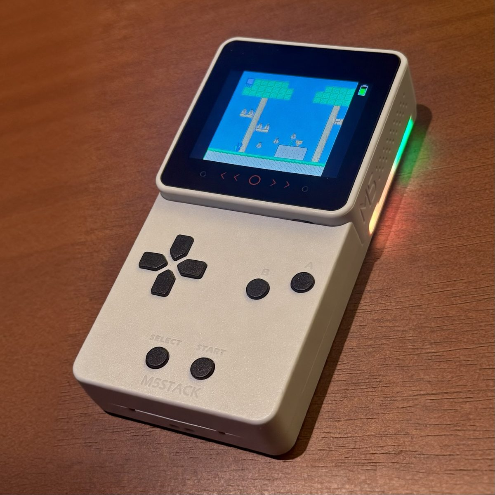
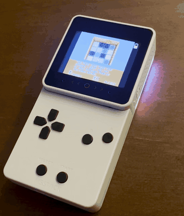
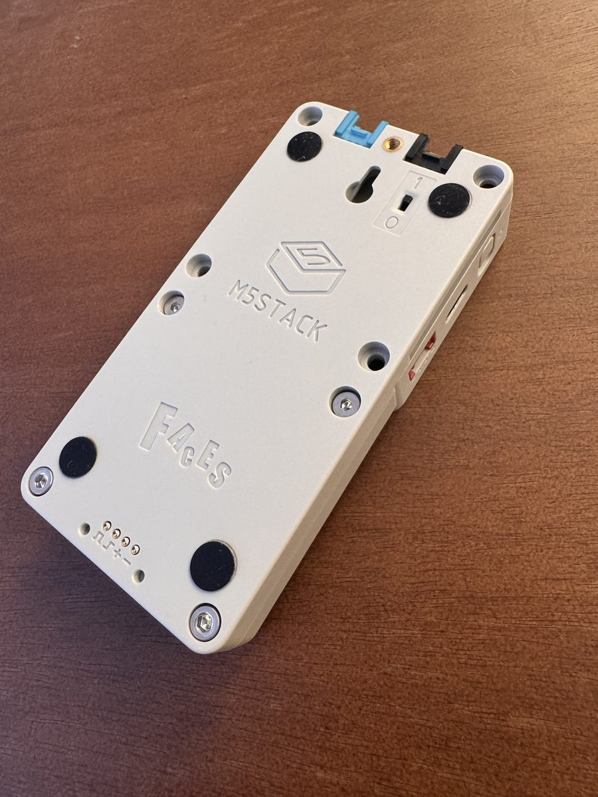
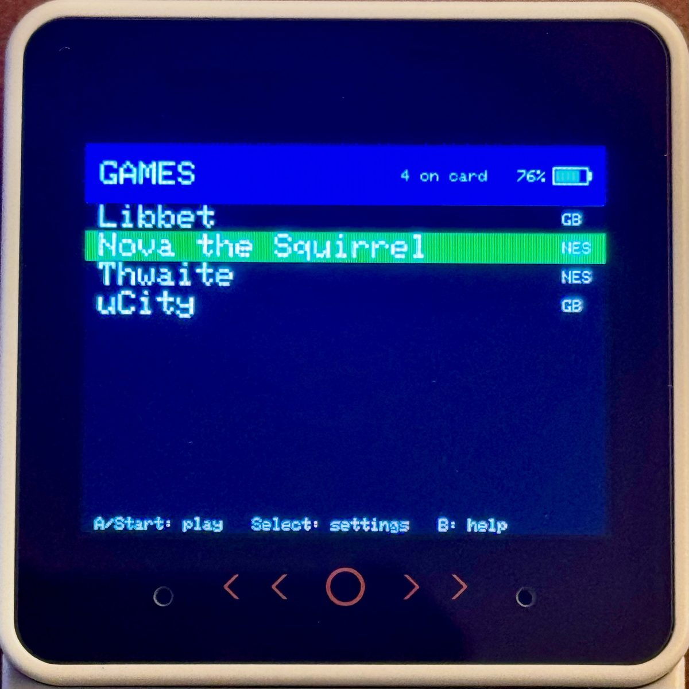
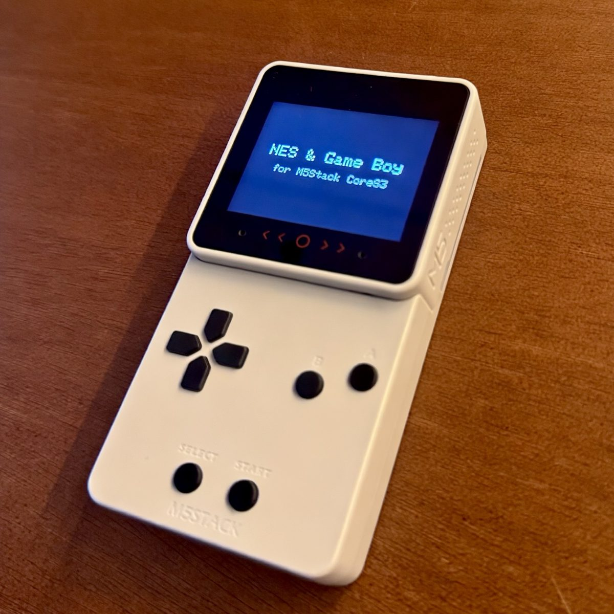
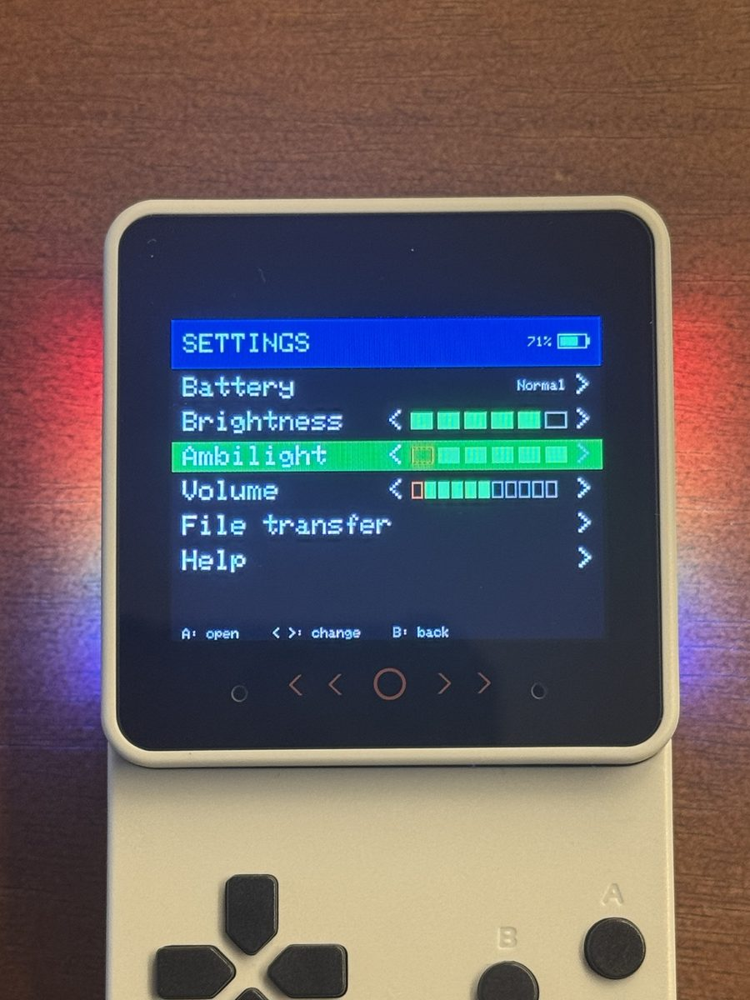
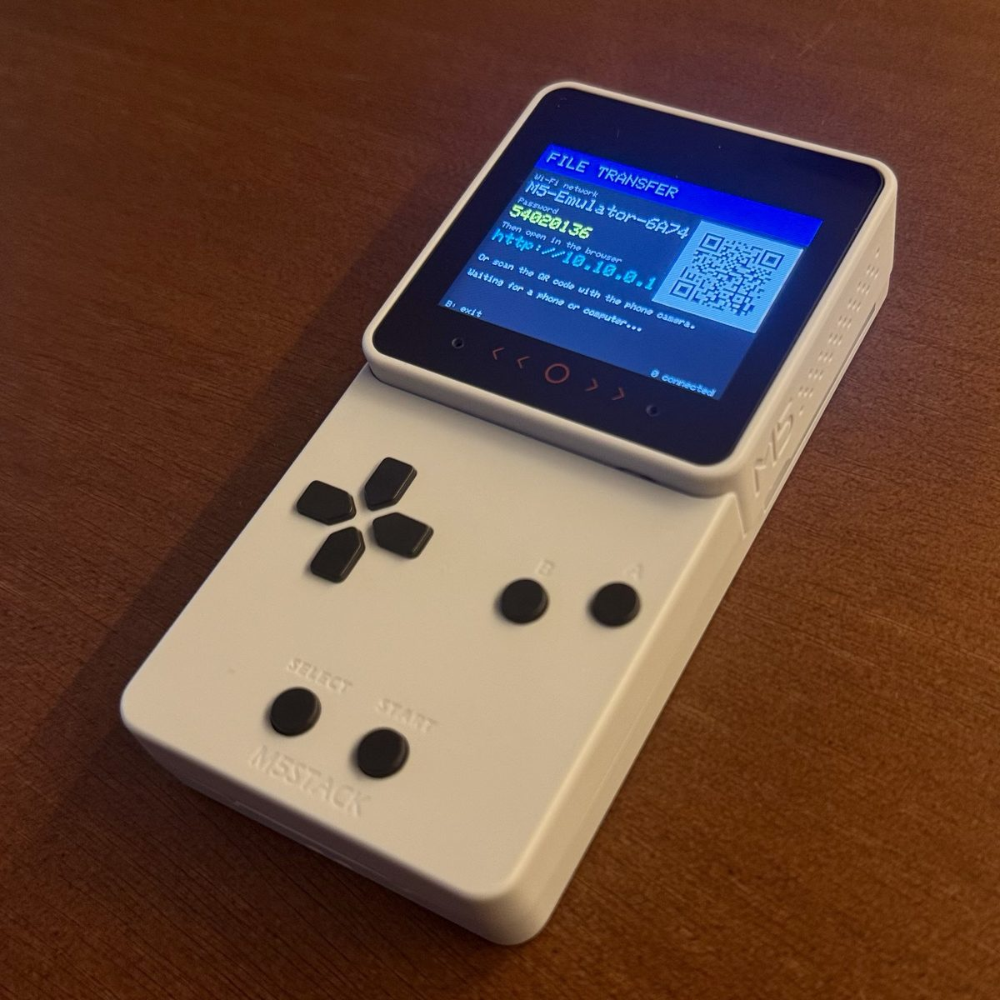

# NES and Game Boy on the M5Stack CoreS3 + Faces

A pocket retro console built from an **M5Stack CoreS3 SE**, the **Faces Bottom3** base and the **Faces Gamepad3**
panel. It plays NES and Game Boy / Game Boy Color games from a microSD card, with the base's battery, its ten RGB LEDs
as a screen-edge "ambilight", and settings you can change without a computer.



> **Status:** works on one CoreS3 SE (the plain CoreS3 is untested), with games from a microSD card or embedded in
> the firmware.

<p align="center"></p>

## What it does

- **NES** (Nofrendo): 60 Hz emulation, every frame on the screen (interlaced: the even lines of one frame, the odd
  lines of the next), picture widened to 272x240 (a TV showed NES pixels wider than tall), sound at 22050 Hz.
- **Game Boy / Color** (gnuboy): 59.73 Hz, picture scaled 5:3 to 266x240 (full height), about 30 frames per second.
- **Game menu** from `/roms` on a FAT32 microSD (up to 64 games) plus any games embedded in the firmware, remembers
  the last one, saves in `/nes_saves` and `/gb_saves`.
- **Pause menu with save states** (Select + Start): save and resume any game at any point, even games with no battery
  save. States of card games go to the card; states of embedded games to the console's own flash.
- **Faces Bottom3 LEDs:** the ten LEDs follow the colors at the left and right edges of the picture (a 16 px strip
  on each side cut into five rectangles, one per LED, each showing its dominant color), with five brightness levels; they also show the volume (right side), the brightness (left side) and pulse red when the
  battery is low.
- **Battery:** the base's 600 mAh cell powers the console without a cable; percent and charge state on screen; four
  charge modes (Normal, Fast, Smart 40-80%, Off) when charging through the console's USB-C.
- **Touch controls** on the icons printed below the screen; in game, the battery icon sits at the top of the right
  strip and the brightness bar on the left (like the original Game Boy: contrast left, volume right).
- **Wi-Fi file transfer:** the console creates its own network, shows a QR code, and you manage games and saves from
  a web page.
- English or Brazilian Portuguese on-screen text (build option).

## What you need

| Part | Notes |
|---|---|
| M5Stack **CoreS3 SE** | The only tested board. |
| M5Stack **Faces Bottom3** (SKU A168) | With its battery. |
| **Faces Gamepad3** panel | Reads over I2C. |
| FAT32 **microSD card** | Optional: games can also be embedded in the firmware. |
| USB-C data cable | For flashing. |

**Set the SELECTION switch on the base to "Core2/CoreS3".** In the "Core" position the LED data line lands on the
speaker's data pin and the LEDs will not work (see [docs/LESSONS.md](docs/LESSONS.md)). The slide switch on the back
of the base connects the battery: "I" is on, "O" is off.

<p align="center"></p>

## Build and flash

Needs [PlatformIO](https://platformio.org/) (Python 3.10 to 3.13).

```sh
cd firmware
pio run -e cores3 -t upload --upload-port <PORT>      # English on-screen text
pio run -e cores3-ptbr -t upload --upload-port <PORT> # Brazilian Portuguese
```

Keep the PlatformIO build folder out of cloud-synced directories (set `PLATFORMIO_WORKSPACE_DIR`).

The build works with no games at all. To play without a card, put `.nes`, `.gb` or `.gbc` files in
`firmware/data/roms/` (not tracked by git): a pre-build script packs them into the firmware, and the file name is the
name in the menu. An optional `firmware/data/logo.png` (240x180) replaces the text boot screen.

## Games

**No games are included.** Use games you own or free homebrew.

1. Format a microSD card as FAT32 and create a folder `roms` in its root.
2. Copy `.nes`, `.gb` or `.gbc` files, **not zipped**.
3. Insert it, power on, pick a game.

Or embed them in the firmware (see Build and flash): they are listed after the card's games. Free homebrew that
runs well: [Nova the Squirrel](https://github.com/NovaSquirrel/NovaTheSquirrel) and
[Thwaite](https://github.com/pinobatch/thwaite-nes) (NES), [Libbet and the Magic Floor](https://github.com/pinobatch/libbet)
(Game Boy, with a demo mode on Select) and [µCity](https://github.com/AntonioND/ucity) (Game Boy Color).

The NES core includes about 40 cartridge mappers (among them MMC1, MMC3 and MMC5), but not every game runs
correctly. Game Boy / Color cartridges with battery RAM keep their save on the card (embedded games need a card to
save too).

<p align="center"> </p>

## Controls

| Where | Control | Action |
|---|---|---|
| Game | D-pad, A, B, Select, Start | The console's buttons. |
| Game | **Select + Start for about 1 s** | Pause menu: Continue, Save state, Load state, Quit to menu (the cartridge save is written first). |
| Menu | Up / Down, **A** or **Start** | Choose and play. |
| Menu | **Select** | Settings. |
| Menu | **B** | Help screen. |
| Game, icons below the screen | `<` / `>` | Lower / raise the active control (volume by default). |
| Game | `o` (middle circle) | Switch between volume and brightness (back to volume after 3 s). |
| Game | Finger held on the screen about 1 s | Mute on / off. |
| Console | Side button: tap | Power on. |
| Console | Side button: hold about 4 s | Power off. |

Settings (Select in the menu): battery and charge mode, brightness (6 levels), ambilight (off and 5 levels, with a
live preview on the LEDs), volume (the first, red box is mute), Wi-Fi file transfer, help. B goes back.

<p align="center"></p>

### Charging

- With the rear switch on "I", the base's cell is the console's battery and charges from the console's USB-C. Charge
  modes only control this path.
- The base's own USB-C and the magnetic Faces Charging3 dock charge through the base's own charger (a TP4057 whose
  status pins are not connected to anything), which the console cannot see or control. The firmware infers it from the
  voltage and shows "Charging (base)" after about 1 to 2 minutes. The four pogo pins on the back are GND, 5 V in, and
  the CoreS3 internal I2C bus (SDA, SCL); the Charging3 dock itself is passive (USB-C with 5.1 kOhm CC resistors).
- The charge settings are kept by the power chip: after "Off" (or a paused "Smart") the device keeps not charging,
  even with new firmware, until you switch the mode back.
- The battery percent is estimated from voltage; the chip's own gauge has not learned the cell.

### Wi-Fi file transfer

<p align="center"></p>

Settings, then File transfer. The console starts a network named `M5-Emulator-XXXX` with a new 8-digit password each
time and shows a QR code. Join it, open `http://10.10.0.1`, and list, upload and delete games, or download and restore
saves. B on the console exits and restarts into the menu. Wi-Fi never runs together with a game.

The screen can not be turned fully off for a Game Boy-like reflective look: the IPS panel shows nothing without its
backlight, so the lowest brightness level is the dimmest step the power chip offers.

## What we learned

The interesting parts are written up in [docs/LESSONS.md](docs/LESSONS.md): the right-edge picture column bug in the
Nofrendo frame buffer, clock-driven audio feeding for `M5.Speaker`, the Faces Bottom3 LED pin, order and power, the
base battery working as the CoreS3 SE battery, touch below the screen, and more, each with how sure we are.

## Language / Idioma

On-screen text is in English by default. The `cores3-ptbr` build environment (`-DUI_LANG_PT_BR=1`) shows Brazilian
Portuguese. All strings are in `firmware/src/ui_text.h`.

## Credits and license

Distributed under the **GNU General Public License, version 2 only** ([LICENSE](LICENSE)), because the Game Boy core is
GPL-2.0 without an "or later" clause. Files derived from MIT projects keep their MIT notices. Components, origins
and changes: [THIRD_PARTY.md](THIRD_PARTY.md). Built on the work of Matthew Conte and the Nofrendo authors,
moononournation, geo-tp (Cardputer Game Station), the gnuboy authors and Alex Duchesne (retro-go), GOROman
(kexi/cluade-famicom-emu-stackchan) and M5Stack.

M5Stack, Faces, CoreS3, Nintendo, NES and Game Boy are trademarks of their respective owners. This project is not
affiliated with or endorsed by any of them.

## Em português

Emulador de NES e Game Boy para o M5Stack CoreS3 SE com a base Faces Bottom3 e o painel Faces Gamepad3. Compile com
`pio run -e cores3-ptbr -t upload` para a tela em português. Ponha a chave SELECTION da base em "Core2/CoreS3". Os
jogos não vêm junto: coloque arquivos `.nes`, `.gb` ou `.gbc` (sem compactar) na pasta `roms` de um cartão microSD
FAT32, ou embuta no firmware pondo-os em `firmware/data/roms/` antes de compilar. Select + Start por cerca de 1 s abre
o menu de pausa, com salvar e carregar estado.
